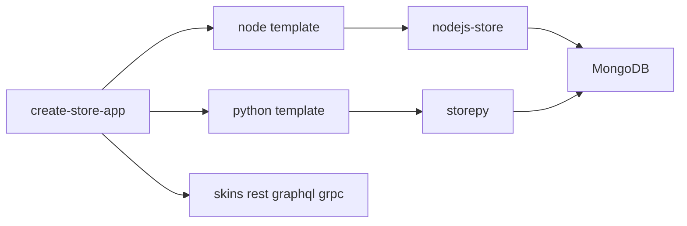

# create-store-app

**One command scaffolds a common-store data application — Node (`nodejs-store`) or Python (`storepy`) — and optionally wires the REST / GraphQL / gRPC protocol skins.**

[](https://www.npmjs.com/package/create-store-app)
[](https://nodejs.org)
[](https://github.com/coenddt/create-store-app/blob/main/LICENSE)

> 中文: [README.md](./README.md)

- Input: a target directory, a language, a set of skins. Output: a complete project that starts with `npm start` or `python impl/bootstrap.py`.
- Every project ships with a sample schema, computed-column implementations, seed data, smoke cases and a definition-publish script.
- It writes no business logic, runs no database migration and embeds no authentication — those are yours.

## Monday morning, the fifth copy of the last skeleton

Suppose it is Monday morning and you owe someone a new orders service. Last quarter's project still works, so you copy it: connection config, schema directory, computed columns, publish script, smoke cases — nine files, with the package name, the database name and the `schema/oldapp/` directory each appearing in several places. You finish, start it, and discover that one database name in `store.config.json` was missed, so the service connected to the neighbouring project's database; then you audit the default database name hard-coded in the start script and lose another afternoon. Of the whole day, the only part that belongs to the new business is one `Order` table — the rest was transcription and name matching.

`create-store-app` collapses that transcription into one generation: every place in the template that varies with the application name is carried by the same placeholder, replaced in one pass, directory names included.

## What it actually does

The whole claim fits in one sentence: **generate the smallest complete file set a data application needs, and make the Node and Python artifacts share one definition semantics.**

| Responsibility | This repository | Notes |
|---|---|---|
| Copy the template | yes | `templates/<lang>/**` → target directory |
| Replace the application name | yes | `__APP_NAME__` → basename of the target directory, in both paths and file contents |
| Wire protocol skins | yes | inject dependencies and startup blocks per `--skins` |
| Resolve definition locations | no, the host does | directory layout plus `store.config.json`, planned by the core alone |
| Business logic / migration / auth | no | you add them after generation; see "Boundaries" |

Arguments come from [`bin/create.js`](bin/create.js):

| Argument | Values | Default | Meaning |
|---|---|---|---|
| `<target-dir>` | path | — | target directory; omitted on a TTY, interactive prompts take over |
| `--lang` | `node` \| `python` | `node` | selects `templates/<lang>` |
| `--skins` | comma-separated `rest` \| `graphql` \| `grpc` | `rest` | at least one; an empty value raises `ERR_ARGS` |
| `--yes` | boolean | `false` | accept every default (`node` + `rest`), ask nothing |
| `--force` | boolean | `false` | overwrite an existing non-empty target directory |
| `-h` / `--help` | boolean | `false` | print usage and exit 0 |

There are only three exit codes: `0` success; `2` argument or template error (`ERR_ARGS`); `3` the target exists and is non-empty without `--force` (`ERR_TARGET_EXISTS`, which also covers a target that exists and is not a directory). Off a TTY, with neither `--lang` nor `--yes`, a supplied directory is generated as the default `node` + `rest`; without a directory the process exits 2 immediately and never waits for input.

## Key mechanisms

### 1. One recursive copy, two renames

`copyTree()` in [`bin/create.js`](bin/create.js) does one thing: for every directory entry it replaces the name first, then decides whether to recurse or write a file; writing a file replaces the full text once more.

```js
const name = entry.name.split(PLACEHOLDER).join(appName);
const dst = path.join(dstDir, name);
if (entry.isDirectory()) copyTree(src, dst, appName);
else fs.writeFileSync(dst, text.split(PLACEHOLDER).join(appName));
```

`appName` is the `basename` of `path.resolve(target)`, so `/code/acme-orders` yields `acme-orders`. A single pass therefore rewrites:

- the path: `schema/__APP_NAME__/Order.json` → `schema/acme-orders/Order.json`;
- the package name: `name` in `package.json` / `name` in `pyproject.toml`;
- the database name: `databases: ["acme-orders"]` in `store.config.json`;
- the runtime default database: the `MONGO_DB` fallback in `impl/bootstrap.js` / `impl/bootstrap.py`.

The template needs no per-location logic; a new file that mentions the application name is just one more placeholder.

### 2. Two languages, one definition semantics

The two templates mirror each other file for file; the differences sit in the runtime and the dependency declarations:

| Dimension | `templates/node` | `templates/python` |
|---|---|---|
| Runtime | Node.js `>=18` | Python `>=3.10` |
| Dependency manifest | `package.json` | `pyproject.toml` |
| Host | `nodejs-store ^4.0.0` | `storepy >=4.0.0` |
| Mongo driver | `mongodb ^6.21.0` (`MongoClient`) | `pymongo >=4.9` (`AsyncMongoClient`) |
| Entry point | `impl/bootstrap.js` calls `createApp({ datasource, config, fns, skins, reload })` | `impl/bootstrap.py` calls `create_app(...)`, then `store_gateway.build(...).run(...)` |
| Publish script | `scripts/publish-defs.js` | `scripts/publish-defs.py` (standard-library `urllib` only) |

`schema/<app>/Order.json` is byte-identical in both templates; computed columns declare only a `fnRef`, with the implementation living in `impl/fns.js` or `impl/fns.py`. The only divergence is the shape of the smoke cases: Node uses HTTP `{ method, path, expect }`, Python uses GQL `{ gql, expect }`.

### 3. Skins are injected, not a second template set

A skin is not a separate template directory; it is a **marked-region replacement** inside the same template. Node injects the startup block between `// __SKINS_START__` and `// __SKINS_END__` in `impl/bootstrap.js` and rewrites the `"__SKIN_DEPS__"` members of `package.json`; Python injects between `# __SKINS_IMPORT_START__` / `# __SKINS_END__` and `# __SKINS_START__` / `# __SKINS_END__`, and writes extras into `pyproject.toml`.

| Skin | Node dependency (`^0.1.0`) and wiring | Python extras and wiring |
|---|---|---|
| `rest` (default) | `store-api-node`, `{ enabled: true, prefix: '/api' }` | `store-gateway-py[rest]`, `rest={"enabled": True, ...}` |
| `graphql` | `store-graphql-node`, `{ enabled: true, path: '/graphql' }` | `store-gateway-py[graphql]` |
| `grpc` | `store-grpc-node`, `GRPC_PORT` defaults to `50051` | `store-gateway-py[grpc]` |

A missing marker raises `ERR_TEMPLATE`; the tool never emits a project where a skin was selected but not wired. `skins.http` is always enabled (`PORT`, default `3000`) and does not count as a skin; `--skins` requires at least one.

### 4. The generated tree (Node template + default REST)

```text
acme-orders/
├── package.json              # name = acme-orders; scripts.start = node impl/bootstrap.js
├── store.config.json         # sources.default = mongodb / ["acme-orders"], defs = ["schema"]
├── schema/
│   └── acme-orders/
│       └── Order.json        # pure JSON definition: fields + computes.amountLabel
├── impl/
│   ├── bootstrap.js          # createApp starts the service; skins block injected per --skins
│   └── fns.js                # computed-column implementation for amountLabel
├── scripts/
│   └── publish-defs.js       # publishes definitions to meta-store; supports --dry-run
├── seed/
│   └── seed.json             # sample data, not an auto-loader script
├── cases/
│   └── smoke.json            # GET /api/Order → 200
└── README.md
```

The Python template is isomorphic: `pyproject.toml` replaces `package.json`, `impl/bootstrap.py` / `impl/fns.py` replace the `.js` counterparts, and every other directory and file name is identical.

## Run it

Node, generate and start in one line (the generation path covered by [`test/smoke.test.js`](test/smoke.test.js)):

```bash
npx create-store-app acme-orders --yes
cd acme-orders
npm install
npm start
# in another terminal
curl http://127.0.0.1:3000/api/Order
```

`--yes` means `--lang node --skins rest`; `npm start` comes from `scripts.start` in the template `package.json`, which is `node impl/bootstrap.js`. The service connects to `mongodb://127.0.0.1:27017` and uses the application name `acme-orders` as the database. `seed/seed.json` is a sample data file only — the project ships no loader — so `curl` shows data only after you load that file into the collection yourself.

Python, the same one command (the template entry point is `impl/bootstrap.py`):

```bash
npx create-store-app acme-py --lang python --skins rest,graphql --yes
cd acme-py
pip install -e .
python impl/bootstrap.py
```

`pyproject.toml` now depends on `store-gateway-py[rest,graphql]`; after startup REST lives at `/api` and GraphQL at `/graphql`.

To select all three skins, use the administration CLI in this repository (it is not declared as an npm bin, so invoke it through `node` explicitly):

```bash
node bin/store-app.js create acme-orders --lang node --skins rest,graphql,grpc --yes
node bin/store-app.js list          # prints the version, available languages, available skins
```

The repository's own test suite is `npm test` (equivalent to `node --test`): 9 cases cover generation for both templates, placeholder replacement, injection of the three skins and the `0/2/3` exit-code contract. All pass today.

## Spec snippet (SPEC)

The contract below is checked segment by segment across three carriers by `tools/check-spec-snippets.js`; quoted verbatim.

<!-- SPEC:LOCATION:BEGIN -->
### Location: directory semantics + connection config (definitions carry no location)

A schema definition file contains no location fields (no `source` / `database` / `schema`; `namespace` is removed). Location is resolved from the definition directory layout plus the connection config:

- Under the definitions root `<defs-root>/`: the first directory level is the `database`; PostgreSQL adds a second level for `schema` (Mongo / MySQL / SQLite have no such level); deeper levels are free-form and flattened at load time (no hierarchy semantics).
- The connection config (`store.config.json`) declares `sources` (`kind` + `databases`) and `defs`; `kind` decides whether that database directory is read one level deeper for `schema`.
- Location fields are `source` / `database` / `schema` (PG only) / `collection`; the word `namespace` is removed.
- Same-named schemas: exactly one primary (no `replica`); the rest declare `{ "name": "...", "replica": true }`, add only a link, and must not repeat the structure. Zero or two-or-more primaries is an error.
- A duplicated `name` within one load batch is an error and the service does not start; re-loading the same `name` across versions bumps its version by 1.
- Writes are synchronized within a single connection, across the primary plus all links, in one transaction; a write spanning a cross-connection link is explicitly rejected or degraded with a feedback event (never silent).
<!-- SPEC:LOCATION:END -->

## Boundaries: when not to use it

- **No business logic.** The template has one sample `Order` table; apart from the demonstration computed column `amountLabel`, there is no domain code.
- **No database migration, no automatic seeding.** `seed/seed.json` is a data file, not a migration tool; schema changes go through `scripts/publish-defs.*` to meta-store, and republishing the same name bumps the version by 1.
- **No built-in authentication or permissions.** The generated project has no login, RBAC or tenant isolation; add `store-rbac-bootstrap` when you need permission decisions.
- **No frontend, mini-program or MCP skin.** This repository produces the data-application server and its definitions only; the available skins are `rest`, `graphql` and `grpc`.
- **It does not adopt an existing project.** It targets a new directory; a non-empty target needs `--force`, and overwriting writes file by file — there is no structural merge or conflict resolution.

## Where it sits in the family

It is the entry point of common-store: downward it picks a host (`nodejs-store` or `py-store`), outward it picks a set of skins (`store-api` / `store-graphql` / `store-grpc`, assembled through `store-gateway`), and upward it leaves one exit for publishing definitions (`meta-store`).

- Hosts: [nodejs-store](https://github.com/coenddt/nodejs-store) · [py-store](https://github.com/coenddt/py-store)
- Engine: [rust-store](https://github.com/coenddt/rust-store)
- Skins: [store-api](https://github.com/coenddt/store-api) · [store-graphql](https://github.com/coenddt/store-graphql) · [store-grpc](https://github.com/coenddt/store-grpc) · [store-gateway](https://github.com/coenddt/store-gateway)
- Control plane: [meta-store](https://github.com/coenddt/meta-store)

## The whole thing on one page


