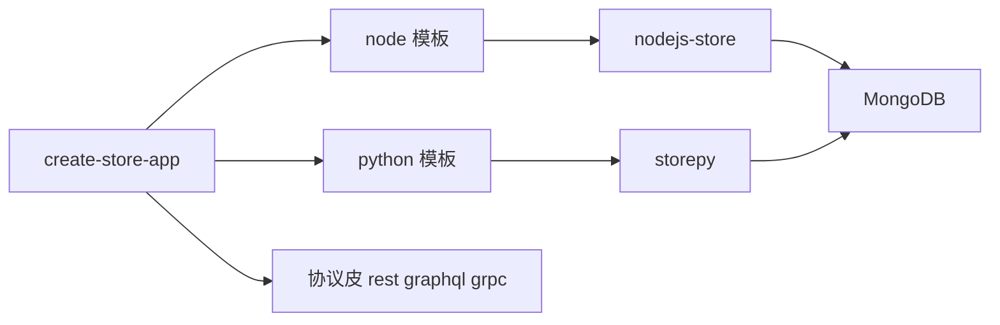

# create-store-app

**一条命令生成 common-store 数据驱动应用的工程骨架**：Node（`nodejs-store`）或 Python（`storepy`）模板，另按需装配 REST / GraphQL / gRPC 协议皮。

[](https://www.npmjs.com/package/create-store-app)
[](https://nodejs.org)
[](https://github.com/coenddt/create-store-app/blob/main/LICENSE)

- 输入：目标目录、语言、协议皮；输出：一个能 `npm start` 或 `python impl/bootstrap.py` 的完整工程。
- 生成物自带示例 schema、计算列实现、种子数据、冒烟用例与定义发布脚本。
- 它不写业务逻辑，不做数据库迁移，不内置认证——这些留给你。

## 周一上午，第五次复制上一份骨架

设想周一上午，你要交付一个新的订单服务。上一份工程还能用，于是你复制过来：连接配置、schema 目录、计算列、发布脚本、冒烟用例，一共 9 个文件，包名、库名、`schema/oldapp/` 的目录名各有几处要改。改完跑起来，发现 `store.config.json` 里的库名漏了一处，服务连到了隔壁项目的库；再检查一遍启动脚本里写死的默认库名，又是一个下午。一天里真正属于这个新业务的，其实只有一张 `Order` 表——其余全是抄写与对名字。

`create-store-app` 把这套抄写收敛成一次生成：模板里所有随应用名变化的位置都由同一个占位符承载，复制时一次性替换，连目录名一起。

## 它到底做什么

核心主张只有一句：**把「起一个数据应用」所需的最小但完整文件集合一次生成，并让 Node 与 Python 两个产物共享同一套 schema 语义。**

| 职责 | 本仓负责 | 说明 |
|---|---|---|
| 复制模板 | 是 | `templates/<lang>/**` → 目标目录 |
| 替换应用名 | 是 | `__APP_NAME__` → 目标目录 basename，路径名与文件内容都替换 |
| 装配协议皮 | 是 | 按 `--skins` 注入依赖与启动装配块 |
| 定义落点解析 | 否，交给宿主 | 目录层级 + `store.config.json`，由 core 纯规划 |
| 业务逻辑 / 迁移 / 认证 | 否 | 生成后由你补，见「边界」 |

参数来自 [`bin/create.js`](bin/create.js)：

| 参数 | 取值 | 默认 | 含义 |
|---|---|---|---|
| `<target-dir>` | 路径 | — | 目标目录；省略且在 TTY 时进入交互问答 |
| `--lang` | `node` \| `python` | `node` | 选择 `templates/<lang>` |
| `--skins` | 逗号分隔的 `rest` \| `graphql` \| `grpc` | `rest` | 至少 1 个，空值报 `ERR_ARGS` |
| `--yes` | 布尔 | `false` | 全取默认（`node` + `rest`），不做任何提问 |
| `--force` | 布尔 | `false` | 目标目录已存在且非空时覆盖 |
| `-h` / `--help` | 布尔 | `false` | 打印用法并以 0 退出 |

退出码只有三种：`0` 成功；`2` 参数或模板错误（`ERR_ARGS`）；`3` 目标已存在且非空、又没给 `--force`（`ERR_TARGET_EXISTS`，目标存在但不是目录也算）。非 TTY 且既无 `--lang` 也无 `--yes` 时，给了目录就按默认 `node` + `rest` 生成，没给目录直接以 2 退出，不会挂起等输入。

## 关键机制

### 1. 一次递归复制，两处改名

[`bin/create.js`](bin/create.js) 的 `copyTree()` 只做一件事：对每个目录项先替换名字，再决定递归还是写文件；写文件时再对全文替换一次。

```js
const name = entry.name.split(PLACEHOLDER).join(appName);
const dst = path.join(dstDir, name);
if (entry.isDirectory()) copyTree(src, dst, appName);
else fs.writeFileSync(dst, text.split(PLACEHOLDER).join(appName));
```

`appName` 是 `path.resolve(target)` 的 `basename`，所以 `/code/acme-orders` 得到 `acme-orders`。于是同一次替换同时改到了：

- 路径：`schema/__APP_NAME__/Order.json` → `schema/acme-orders/Order.json`；
- 包名：`package.json` 的 `name` / `pyproject.toml` 的 `name`；
- 库名：`store.config.json` 里 `databases: ["acme-orders"]`；
- 运行期默认库：`impl/bootstrap.js` / `impl/bootstrap.py` 里 `MONGO_DB` 的缺省值。

模板不需要为每个位置写特殊逻辑，新增一个含应用名的文件也只是多一个占位符。

### 2. 两种语言，同一套定义语义

两个模板的文件骨架一一对应，差别集中在运行时与依赖声明：

| 维度 | `templates/node` | `templates/python` |
|---|---|---|
| 运行时 | Node.js `>=18` | Python `>=3.10` |
| 依赖清单 | `package.json` | `pyproject.toml` |
| 宿主 | `nodejs-store ^4.0.0` | `storepy >=4.0.0` |
| Mongo 驱动 | `mongodb ^6.21.0`（`MongoClient`） | `pymongo >=4.9`（`AsyncMongoClient`） |
| 入口 | `impl/bootstrap.js` 调 `createApp({ datasource, config, fns, skins, reload })` | `impl/bootstrap.py` 先 `create_app(...)`，再 `store_gateway.build(...).run(...)` |
| 发布脚本 | `scripts/publish-defs.js` | `scripts/publish-defs.py`（只用标准库 `urllib`） |

两个模板的 `schema/<app>/Order.json` 内容完全一致，计算列都只写 `fnRef`，实现分别落在 `impl/fns.js` 与 `impl/fns.py`。差异只在冒烟用例的形态：Node 是 HTTP 的 `{ method, path, expect }`，Python 是 GQL 的 `{ gql, expect }`。

### 3. 协议皮是注入，不是另生成一套模板

协议皮不是不同的模板目录，而是对同一份模板做**标记区间替换**。Node 注入 `impl/bootstrap.js` 的 `// __SKINS_START__` 与 `// __SKINS_END__` 之间的装配块，并改写 `package.json` 里的 `"__SKIN_DEPS__"` 成员；Python 注入 `# __SKINS_IMPORT_START__` / `# __SKINS_END__` 与 `# __SKINS_START__` / `# __SKINS_END__`，并把 extras 写进 `pyproject.toml`。

| 皮 | Node 依赖（`^0.1.0`）与装配 | Python extras 与装配 |
|---|---|---|
| `rest`（默认） | `store-api-node`，`{ enabled: true, prefix: '/api' }` | `store-gateway-py[rest]`，`rest={"enabled": True, ...}` |
| `graphql` | `store-graphql-node`，`{ enabled: true, path: '/graphql' }` | `store-gateway-py[graphql]` |
| `grpc` | `store-grpc-node`，`GRPC_PORT` 缺省 `50051` | `store-gateway-py[grpc]` |

标记缺失时直接抛 `ERR_TEMPLATE`，不会生成一个"皮选了但没接上"的工程。`skins.http` 固定启用（`PORT`，默认 `3000`），它不算协议皮；`--skins` 至少要有 1 个。

### 4. 生成后的目录（Node 模板 + 默认 REST）

```text
acme-orders/
├── package.json              # name = acme-orders；scripts.start = node impl/bootstrap.js
├── store.config.json         # sources.default = mongodb / ["acme-orders"]，defs = ["schema"]
├── schema/
│   └── acme-orders/
│       └── Order.json        # 纯 JSON 定义：fields + computes.amountLabel
├── impl/
│   ├── bootstrap.js          # createApp 起服务，skins 块已按 --skins 注入
│   └── fns.js                # 计算列实现 amountLabel
├── scripts/
│   └── publish-defs.js       # 发布定义到 meta-store，支持 --dry-run
├── seed/
│   └── seed.json             # 示例数据，不是自动装载脚本
├── cases/
│   └── smoke.json            # GET /api/Order → 200
└── README.md
```

Python 模板同构：`pyproject.toml` 取代 `package.json`，`impl/bootstrap.py` / `impl/fns.py` 取代对应的 `.js`，其余目录与文件名一致。

## 跑起来

Node，一条命令生成并启动（对应 [`test/smoke.test.js`](test/smoke.test.js) 中验证过的生成路径）：

```bash
npx create-store-app acme-orders --yes
cd acme-orders
npm install
npm start
# 另一个终端
curl http://127.0.0.1:3000/api/Order
```

`--yes` 等价于 `--lang node --skins rest`；`npm start` 来自模板 `package.json` 的 `scripts.start`，即 `node impl/bootstrap.js`。服务连本机 `mongodb://127.0.0.1:27017`，库名默认取应用名 `acme-orders`。模板里的 `seed/seed.json` 只是一份示例数据文件，工程没有附带装载脚本；想让 `curl` 看到数据，需要先自行把它灌进对应的集合。

Python，同样一条命令（模板入口是 `impl/bootstrap.py`）：

```bash
npx create-store-app acme-py --lang python --skins rest,graphql --yes
cd acme-py
pip install -e .
python impl/bootstrap.py
```

此时 `pyproject.toml` 的依赖里会出现 `store-gateway-py[rest,graphql]`，启动后 REST 在 `/api`、GraphQL 在 `/graphql`。

一次选齐三种皮，用同仓的管理 CLI（它未声明为 npm bin，需显式走 `node`）：

```bash
node bin/store-app.js create acme-orders --lang node --skins rest,graphql,grpc --yes
node bin/store-app.js list          # 打印版本、可用语言、可用协议皮
```

本仓自测即 `npm test`（等价 `node --test`）：9 条用例覆盖两种模板的生成、占位符替换、三种皮的注入与 `0/2/3` 退出码契约，当前全部通过。

## 规范片段（SPEC）

以下契约由 `tools/check-spec-snippets.js` 在三处载体间逐段校验，原文照录。

<!-- SPEC:LOCATION:BEGIN -->
### Location: directory semantics + connection config (definitions carry no location)

A schema definition file contains no location fields (no `source` / `database` / `schema`; `namespace` is removed). Location is resolved from the definition directory layout plus the connection config:

- Under the definitions root `<defs-root>/`: the first directory level is the `database`; PostgreSQL adds a second level for `schema` (Mongo / MySQL / SQLite have no such level); deeper levels are free-form and flattened at load time (no hierarchy semantics).
- The connection config (`store.config.json`) declares `sources` (`kind` + `databases`) and `defs`; `kind` decides whether that database directory is read one level deeper for `schema`.
- Location fields are `source` / `database` / `schema` (PG only) / `collection`; the word `namespace` is removed.
- Same-named schemas: exactly one primary (no `replica`); the rest declare `{ "name": "...", "replica": true }`, add only a link, and must not repeat the structure. Zero or two-or-more primaries is an error.
- A duplicated `name` within one load batch is an error and the service does not start; re-loading the same `name` across versions bumps its version by 1.
- Writes are synchronized within a single connection, across the primary plus all links, in one transaction; a write spanning a cross-connection link is explicitly rejected or degraded with a feedback event (never silent).
<!-- SPEC:LOCATION:END -->

## 边界：什么时候不要用它

- **不生成业务逻辑**：模板只有一张 `Order` 示例表；除 `amountLabel` 这个演示计算列外，没有任何领域代码。
- **不做数据库迁移，也不自动铺种子**：`seed/seed.json` 是数据文件而非迁移工具；schema 变更要靠 `scripts/publish-defs.*` 发布到 meta-store，重发同名定义版本 +1。
- **不内置认证与权限**：生成物没有登录、RBAC 或租户隔离；需要权限判定时另接 `store-rbac-bootstrap`。
- **不生成前端 / 小程序 / MCP 皮**：本仓只产出数据应用服务端与定义，协议皮也只有 `rest` / `graphql` / `grpc` 三种。
- **不接管既有工程**：它面向新目录；目标非空必须 `--force`，而覆盖是逐文件写入，不做结构合并或冲突合并。

## 在家族里的位置

它是 common-store 的入口：向下选一个宿主（`nodejs-store` 或 `py-store`），向外选一组协议皮（`store-api` / `store-graphql` / `store-grpc`，经 `store-gateway` 装配），向上留一个发布定义的出口（`meta-store`）。

- 宿主：[nodejs-store](https://github.com/coenddt/nodejs-store) · [py-store](https://github.com/coenddt/py-store)
- 引擎：[rust-store](https://github.com/coenddt/rust-store)
- 协议皮：[store-api](https://github.com/coenddt/store-api) · [store-graphql](https://github.com/coenddt/store-graphql) · [store-grpc](https://github.com/coenddt/store-grpc) · [store-gateway](https://github.com/coenddt/store-gateway)
- 控制面：[meta-store](https://github.com/coenddt/meta-store)

## 一图看懂


